# Labs64.IO :: AuditFlow

**Audit logging for microservices: publish once, route anywhere, lose nothing.**
*Part of the [Labs64.IO Ecosystem](https://labs64.io): the audit-event router that sits behind your services.*

[**Get started**](https://labs64.io/docs/modules/auditflow/#quick-start) · [Built for enterprise landscapes](#built-for-enterprise-landscapes) · [Features](#features) · [Architecture](https://labs64.io/docs/modules/auditflow/#architecture) · [AI agents](#using-it-with-ai-agents) · [Ecosystem](#the-labs64io-ecosystem) · [Documentation](https://labs64.io/docs/modules/auditflow/) · [labs64.io](https://labs64.io)

> [!NOTE]
> AuditFlow is a **router, not a system of record**. It has no database of its own by design; your destinations own retention and query.

## Why AuditFlow?

Every team ends up building audit logging more than once. One service writes to a table, another calls a logging API, a third does nothing until an auditor asks. The rules for *what* to capture, *where* it goes and *which fields must never be stored* are copied from service to service and quietly drift apart, and you find out at the worst possible moment.

1. **Your service makes one REST call.** No SDK, no broker client, no per-destination code to maintain.
2. **AuditFlow protects and routes the event.** Sensitive fields are masked before anything is stored, then your YAML pipelines decide where it goes.
3. **Every destination gets it, reliably.** Retries over hours, a replayable dead-letter queue and per-tenant isolation mean an outage at a sink does not become a hole in your audit trail.

AuditFlow complements OpenTelemetry rather than replacing it: OpenTelemetry tells you whether your system is healthy; AuditFlow tells you who did what, when, and with what outcome.

**A good fit if**

- You must answer "who did what, when, from where" across several services, and each service does it differently today.
- Records and events have to move between systems that speak different formats, and you are tired of rebuilding that glue for every consumer.
- Data has to reach more than one place, and each place has its own rules, without hand-wiring every route.
- Personal or confidential data must never reach a downstream store, and redaction at the door is a hard requirement.
- You can not afford silent loss: a downstream outage must delay delivery, not drop evidence.
- Business units or customers need their own routing and credentials, isolated from each other.

**Probably not what you need if**

- You only need traces, metrics or infrastructure logs: reach for OpenTelemetry, Prometheus or your observability platform.
- You want to intercept raw HTTP traffic at a proxy or sidecar: AuditFlow is event-driven and your services decide what to publish.
- You want AuditFlow itself to be the queryable store: it deliberately has no database; your sinks own retention and query.

## Built for enterprise landscapes

Enterprise integration is rarely one clean pipe. It is many systems that speak many formats, many destinations with their own rules, business units that must stay apart, regulators who ask questions later, and a landscape that keeps changing. AuditFlow is designed for exactly that mess.

| Your landscape| AuditFlow's answer |
|---|---|
| **Many systems, many formats** | One simple contract in. Transformers normalize each source once, and an open event vocabulary lets every system keep its own terms. |
| **Many destinations, each different** | Fan-out pipelines deliver one event to as many destinations as you need, each failing and recovering on its own. A destination you do not see in the catalogue is a small module, not a project. |
| **Business units that must stay apart** | Tenants are isolated by construction: their own pipelines, quotas and credentials, and no path from one tenant's events into another's destinations. |
| **Confidential and regulated data** | Fields are masked, hashed or dropped at the door, before anything is buffered or stored. Evidence can be archived in a tamper-evident form. |
| **Operations that cannot fail silently** | Delivery is confirmed, retried over hours and parked in a replayable queue when it cannot complete. A downstream outage becomes a delay, not a gap. |
| **A landscape that keeps changing** | Routing is configuration, not code: change it live, test it with a dry run, and add formats or destinations without rebuilding or redeploying anything else. |
| **Run it your way** | Containers and Kubernetes-native, on any cloud or on premises, with telemetry your operations team already understands. |

### Recognise yourself?

- **Integration and platform teams** who are handed "can you just get X into Y?" every month, and want each answer to come with retries, redaction and an owner.
- **Security and compliance** who need a dependable trail, delivered to the places evidence has to live, with sensitive fields handled once and correctly.
- **Data and application owners** who need records to flow between systems and formats without every consumer maintaining its own mapping.
- **Architects** who want one governed integration pattern instead of a growing collection of scripts.

### What is built in, and what is yours

The common formats and destinations are in the catalogue and ready to use. Anything unusual (a proprietary format, an internal system, a destination only your organisation runs) is a small module that you own and that inherits everything above. We will tell you plainly which of your needs is which, and the [catalogue](https://labs64.io/docs/modules/auditflow/sinks-and-transformers/) is the place to check. If your case is not covered, [open an issue](https://github.com/Labs64/labs64.io-auditflow/issues) and describe it.

## Features

- **Pipeline-as-configuration**: destinations and conditions live in YAML; adding or rerouting one needs no rebuild and no restart.
- **Intelligent routing**: field-level conditions (nested paths, AND/OR groups, CIDR, regex, wildcard) plus a dry run that shows which pipelines a sample event would reach.
- **Asynchronous by design**: events are buffered on the message broker (RabbitMQ or Amazon SQS, a configuration choice) before processing, so API latency stays flat under bursts.
- **Multi-destination fan-out**: one publish can reach search, archive, SIEM and webhooks; pipelines fail independently.
- **Redaction at ingest**: sensitive fields are masked, hashed or dropped before they reach the broker.
- **Multi-tenant by construction**: every tenant owns its pipelines, quota and credentials; there is no cross-tenant fall-through.
- **Resilient delivery**: idempotent processing, retry tiers, circuit breaking and a per-tenant dead-letter queue with replay.
- **Pluggable**: a catalogue of common destinations ships ready (search, object storage, databases, log and security platforms, webhooks), and anything else is a small Python module loaded at runtime.
- **Observable**: OpenTelemetry traces, metrics and logs, with a ready-made Grafana dashboard.

The complete list is in the [Features documentation](https://labs64.io/docs/modules/auditflow/features/).

## AuditFlow and OpenTelemetry

They look alike (both capture events from your services and ship them somewhere) but they answer different questions for different people.

| | OpenTelemetry / observability | AuditFlow |
|---|---|---|
| **Question answered** | *Is my system healthy?* Latency, errors, throughput | *Who did what, when, with what outcome?* Intentional actions by users and services |
| **Main reader** | SREs and platform engineers | Compliance, security, legal and auditors |
| **Data character** | High volume, sampled, short retention | Every event matters, lossless, long retention |
| **When it goes wrong** | A dropped span is a gap in a graph | A dropped audit event is a compliance failure |

Both belong in a production system. AuditFlow is built around the assumption that **every event matters**, which is why it has idempotency, a dead-letter queue, retries and ingest-time redaction.

## Using it with AI agents

An agent can record what it did with one HTTP call per action and no SDK. The [guide for AI agents](https://labs64.io/docs/introduction/ai-agents.html) covers authentication, retries and errors across all modules. Working on this repository with an agent? [`AGENTS.md`](AGENTS.md) and [`CLAUDE.md`](CLAUDE.md) describe the layout, conventions and test commands.

## The Labs64.IO Ecosystem

AuditFlow is one module of the [Labs64.IO Ecosystem](https://labs64.io); [every module is documented here](https://labs64.io/docs/).

| Module | What it does | Link |
|---|---|---|
| **AuditFlow** | Audit-event routing pipeline | [labs64.io-auditflow](https://github.com/Labs64/labs64.io-auditflow) |
| **API Gateway** | Authenticating, policy-enforcing edge for all modules | [labs64.io-authproxy](https://github.com/Labs64/labs64.io-authproxy) |
| **Payment Gateway** | One API over multiple payment providers | [labs64.io-payment-gateway](https://github.com/Labs64/labs64.io-payment-gateway) |
| **Checkout** | Embeddable, brandable checkout | [labs64.io-checkout](https://github.com/Labs64/labs64.io-checkout) |
| **Reporting** | Read-only reports over the events AuditFlow stored | [labs64.io-reporting](https://github.com/Labs64/labs64.io-reporting) |
| **Customer Portal** | Customer self-service UI | [labs64.io-customer-portal](https://github.com/Labs64/labs64.io-customer-portal) |
| **Commons** | Shared Java and Python libraries | [labs64.io-commons](https://github.com/Labs64/labs64.io-commons) |
| **Helm Charts** | Kubernetes deployment for every module | [labs64.io-helm-charts](https://github.com/Labs64/labs64.io-helm-charts) |
| **Workspace** | Dev container and multi-repo tooling | [labs64.io-workspace](https://github.com/Labs64/labs64.io-workspace) |
| **Tests** | Cross-module regression suite | [labs64.io-tests](https://github.com/Labs64/labs64.io-tests) |
| **Docs** | Published documentation | [labs64.io-docs](https://github.com/Labs64/labs64.io-docs) |
| **NetLicensing** | Licensing-as-a-Service: license and entitlement management | [netlicensing.io](https://netlicensing.io) |
| **GuideChimp** | Interactive guided product tours | [labs64.com/guidechimp](https://www.labs64.com/guidechimp/) |

## Contributing

We would love your help. Good first areas are new condition operators, transformers and sinks, and documentation or examples. Fork the repository, make your change on a branch, run the checks described in [`AGENTS.md`](AGENTS.md) and open a pull request. For a new sink or transformer, the [plugin guide](DEVELOPERS.md#adding-a-new-sink) is the place to start. Not sure whether an idea fits? Open an issue first and we will talk it through; that is a perfectly good way to start.

## License

Everything in this repository is open source under the [Apache License 2.0](LICENSE): you can use it, change it and ship it commercially. The core of the *Labs64.IO Ecosystem* is free forever; community modules are Apache-2.0 licensed.

---

   
  Made by the <a href="https://labs64.io">Labs64</a> team and community.

